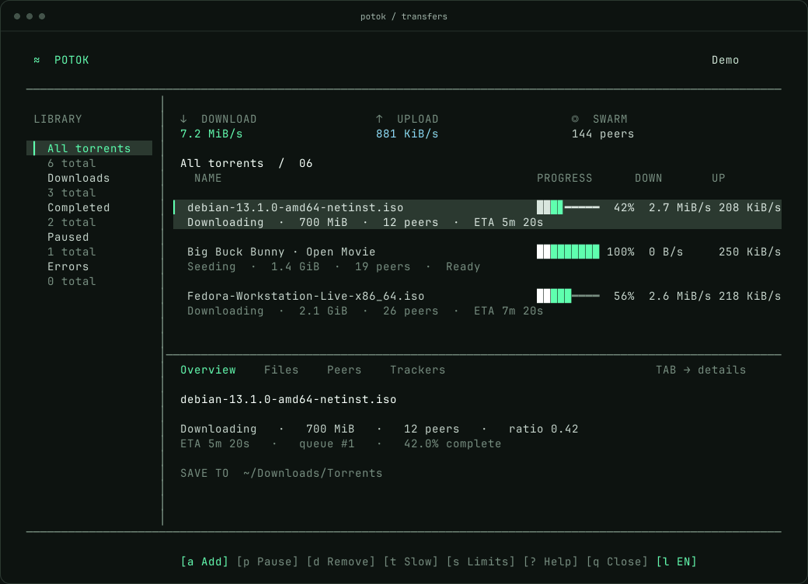
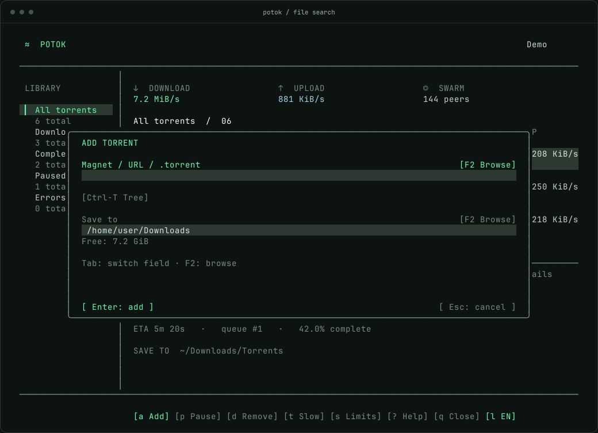

<p align="center">
  
</p>
<h1 align="center">Potok</h1>
<p align="center">A BitTorrent client for the terminal.</p>
<p align="center">
  <a href="#build">Build</a> · <a href="#controls">Controls</a> · <a href="#settings">Settings</a> · <a href="README.ru.md">Документация</a>
</p>



<p align="center"><sub>Potok in demo mode. Transfers shown here are sample data.</sub></p>

Add a magnet link, a local `.torrent`, or an HTTP(S) torrent URL. Use the keyboard
or mouse to pause transfers, select files and inspect peers. Closing the terminal
leaves the downloads running.

##  Build

```sh
# Arch Linux
sudo pacman -S --needed base-devel pkgconf ncurses boost libtorrent-rasterbar

# Debian / Ubuntu
sudo apt install build-essential pkg-config libncurses-dev libtorrent-rasterbar-dev

make -j2
./potok
```

The interface is C11; the libtorrent adapter is C++17. Runtime libraries are
ncursesw, libtorrent-rasterbar, OpenSSL and the system C/C++ runtime. Boost
headers are required to build. Optional tools: `fzf` for file search and
`xdg-open` for opening download folders.

Linux with libtorrent 2.1.2 is tested. Use a terminal of at least 80×24;
108×36 or larger leaves more room for details. Potok uses the terminal background,
including its transparency.

`sudo make install` installs to `/usr/local`. For packaging, use
`make DESTDIR="$PWD/stage" PREFIX=/usr install`. `make source` builds a source
archive; `make bundle` creates `dist/potok/` with a copy of libtorrent. The bundle
still requires compatible system libraries.

An Arch [PKGBUILD](packaging/aur/potok-git/PKGBUILD) is included. It has not been
published to AUR.

##  Find a torrent

```sh
potok path/to/file.torrent
potok "$HOME/Downloads/my file.torrent"
potok --background file.torrent
```

Press `a` to paste a link or choose a file. The form shows the destination and
available disk space. `Tab` switches fields; `Enter` adds the torrent.
Both fields have a **Browse** button. `F2` or `Ctrl-F` opens a picker for the
active field: a torrent file for the source, a directory for **Save to**.



`Ctrl-T` opens the directory tree. Type to filter results, use `← →` or click to
fold and unfold branches, then `Enter` to select a file. `f` opens fzf when it is
installed, otherwise the built-in tree. Both search the home directory by default.
Set `browse_dir` to change the root, or type a directory in the source field
before searching. The tree appears after scanning; symlink directories are skipped.
Traversal is limited to 32 levels and 100,000 torrent files.

In **Save to**, click **Browse** or press `F2` to browse folders. `Enter` enters a
folder, `←` goes up and `F2` selects the current one.

##  Controls

| Key | Action |
|---|---|
| `↑ ↓` / `j k` | Select a torrent |
| `a` / `f` | Add a source / search torrent files |
| `F2` in Add | Browse for the active field: torrent file or download folder |
| `p` / `Space` | Pause or resume |
| `Enter` | Open the download folder |
| `Tab` / `← →` | Switch panes / detail tabs |
| `1` … `5` / `/` | Switch sidebar section / filter by name |
| `s` / `t` | Set speed limits / toggle slow mode |
| `v` / `K J` | Verify data / move in queue |
| `d` | Remove a torrent; optionally delete its files |
| `q` / `Ctrl-C` | Close the interface; keep downloading |
| `Q` | Stop downloads after confirmation |
| `?` | Show all shortcuts |

The mouse selects rows, tabs, buttons and file checkboxes; the wheel scrolls.
**Completed** includes finished torrents on pause. **Seeding** means a torrent
offers its completed data to other peers.
Completed progress bars stay still while uploads continue.

In the removal dialog, leave **Delete downloaded files** unchecked to keep the
data. Checking it also deletes complete or partial downloads, without a recycle
bin. Other files and the original imported `.torrent` are kept.

##  Background downloads

Potok starts its worker automatically. `q` closes the interface, and reopening
`potok` reconnects to the same worker. To manage it without the interface:

```sh
potok --background
potok --status
potok --stop
```

No boot service is installed. After a reboot, run `potok` or `potok --background`
to resume saved transfers. Use the same profile options for start, status and stop.

## Settings

Downloads go to `~/Downloads`. Settings live in `~/.config/potok/config`;
state lives in `~/.local/share/potok`. `XDG_CONFIG_HOME` and `XDG_DATA_HOME` are
respected. A configuration uses absolute paths:

```ini
download_dir=/home/user/Downloads
state_dir=/home/user/.local/share/potok
browse_dir=/home/user
```

The destination selected in the add form is saved after a successful import.
`--download-dir`, `--state-dir` and `--config-dir` override the defaults.
Changing `state_dir` selects a different profile; it does not move downloads.
Keep the state directory private: resume files can contain tracker addresses.
Press `l` to change and save the interface language; `--lang en|ru` overrides it for one run.

## Development

```sh
make test
make sanitize
```

Tests cover terminal input, mouse events, file search, settings and BitTorrent
transfers over loopback, including worker restart and deletion. Public swarms
are excluded from automatic tests. A manual Debian netinst download on
2026-10-24 matched the official SHA-256.

Local peers may bypass global rate limits under libtorrent defaults, and paused
speed statistics can take a few seconds to decay. Torrent creation and tracker
editing are not implemented. macOS, private trackers and extended soak tests
have not been validated.

[MIT](LICENSE). libtorrent-rasterbar uses [BSD-3-Clause](LICENSE.libtorrent).
